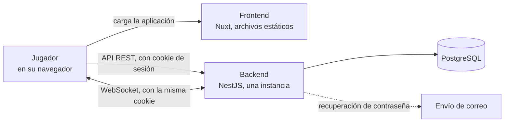
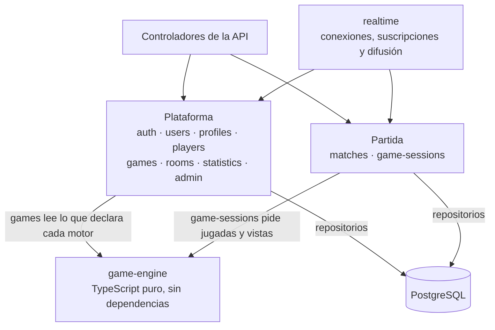

# Arquitectura lógica y módulos

| Campo | Valor |
|---|---|
| **Estado** | Versión 1, aceptada el 2026-11-16 por Fernando Hernandez Argueta |
| **Sustituye a** | El documento de arquitectura inicial |
| **Recoge** | ADR-001 a ADR-007, el modelo de datos y los cinco contratos |
| **Resuelve** | Hallazgo C-19 (el diagrama dibujaba la base de datos debajo del motor) |

**Cómo leer este documento.** Casi todo resume decisiones ya aceptadas y cita su origen. Lo que este documento añade por su cuenta está en la [sección 9](#9-decisiones-propias-de-este-documento).

---

## 1. Vista general

| Pieza | Tecnología | Origen |
|---|---|---|
| Frontend | Nuxt, Vue y TypeScript. Se renderiza en el navegador, con las páginas públicas pregeneradas. No tiene servidor propio | ADR-006; ADR-007, acuerdo B9 |
| Backend | NestJS 12 sobre Node.js 26, con TypeScript estricto. Un solo proceso | ADR-001 |
| Base de datos | PostgreSQL, con Drizzle y migraciones SQL versionadas | ADR-002 |
| Tiempo real | WebSocket nativo con protocolo propio | ADR-003 |
| Identidad | Sesión de servidor con cookie | ADR-004 |
| Envío de correo | Solo para recuperar la contraseña. En local se simula. El servicio real se elige con el alojamiento | ADR-008, punto 17 |

El frontend y el backend se alojan por separado, en subdominios de un mismo dominio (ADR-004). Dónde se alojan está aplazado. No hay Redis ni varias instancias en el MVP (ADR-007, acuerdo B7).

---

## 2. Qué va por cada canal

| Canal | Qué lleva | Contrato |
|---|---|---|
| **API REST** | Registro y sesión, cuenta, perfiles, catálogo, salas (crear, listar, ver, entrar, salir, marcarse listo), consulta de partidas, administración | [`01-rest-api.yaml`](../contracts/01-rest-api.yaml) |
| **WebSocket** | Suscripción a salas y partidas, jugadas, rendición, y los avisos en vivo del servidor | [`02-realtime.md`](../contracts/02-realtime.md) |

Cada operación existe en un solo canal. La API cambia las salas; el WebSocket lleva la partida (decisiones T1 y T2 del protocolo).

---

## 3. Dentro del backend

Las flechas indican quién usa a quién.

- **El motor de juego no tiene ninguna flecha de salida**: no conoce la base de datos, la red ni los demás módulos. Recibe un estado y una jugada, y devuelve el estado nuevo. Quien guarda y quien avisa es la capa de sesión de juego.
- **Los avisos a los clientes van en sentido contrario y no aparecen en el diagrama.** Los módulos no conocen el WebSocket: publican a través de una interfaz de difusión, que `realtime` implementa, y solo después de guardar (regla 7 de la sección 5).

---

## 4. Módulos del backend

| Módulo | Responsabilidad | Tablas que le pertenecen |
|---|---|---|
| `auth` | Registro, inicio y cierre de sesión, sesiones de autenticación, contraseñas y su recuperación. Comprueba sesión y rol en la entrada | `auth_sessions`, `password_reset_tokens` |
| `users` | La cuenta: credenciales, estado y rol | `users` |
| `profiles` | Cómo se presenta la persona | `profiles` |
| `players` | La identidad que participa en salas y partidas | `players` |
| `games` | Catálogo de juegos y versiones. **No contiene reglas** | `games`, `game_versions` |
| `rooms` | Salas: capacidad, pertenencia, marca de listo, cierre por inactividad | `rooms`, `room_players` |
| `matches` | La partida como registro: participantes, asientos, estado y resultado | `matches`, `match_players`, `match_results`, `player_results` |
| `game-sessions` | El estado vivo de una partida: aplica jugadas con el motor, lleva los relojes, detecta vencimientos y abandonos, y recupera tras un reinicio | `game_sessions`, `match_actions`, `server_liveness` |
| `realtime` | Conexiones WebSocket, suscripciones en memoria, presencia y difusión. Es el único módulo que conoce el transporte | Ninguna |
| `statistics` | Contadores por jugador y juego | `game_statistics` |
| `admin` | Operaciones de administración. No tiene datos propios: usa los demás módulos | Ninguna |
| `broadcast` | La interfaz neutral por la que los módulos avisan de lo que cambió y preguntan quién está conectado, sin conocer el WebSocket. `realtime` la implementa (ADR-013, decisión H5) | Ninguna |
| `database`, `config`, `common` | Infraestructura compartida y acotada: conexión, configuración, sobre de respuesta y errores | Ninguna |

`game-engine` no es un módulo del backend: es un paquete aparte que el backend usa (ADR-005). Contiene el contrato del motor y los motores concretos.

Las 17 tablas del [modelo de datos](03-dominio-datos.md) tienen un único módulo dueño.

---

## 5. Dependencias y límites

| # | Regla | Origen |
|---|---|---|
| 1 | El motor de juego no importa NestJS, Drizzle, WebSocket ni ningún módulo del backend. Se comprueba de forma automática | ADR-001, condición 5.5 |
| 2 | El motor conoce asientos, no jugadores ni cuentas. La plataforma traduce | Contrato del motor |
| 3 | La sesión de juego obtiene el motor de un registro, por nombre corto del juego y versión | ADR-007, acuerdo B3 |
| 4 | El resultado por asiento lo determina siempre el motor. La capa de sesión añade el motivo | ADR-009, regla 7.17 |
| 5 | El reloj lo lleva la capa de sesión, no el motor | ADR-009, regla 7.8 |
| 6 | `realtime` es el único módulo que conoce el transporte. Valida el sobre y delega en los servicios de aplicación | ADR-003, condición 5.2 |
| 7 | Todo mensaje saliente pasa por una única interfaz de difusión, y solo después de guardar | ADR-003, condición 5.3; ADR-010, regla 8.9 |
| 8 | Todo acceso a datos pasa por repositorios por módulo. Ningún controlador, gateway ni motor importa Drizzle | ADR-002, condición 5.4 |
| 9 | La identidad sale de la sesión de autenticación. Nunca de un identificador enviado por el cliente | ADR-007, acuerdo B11 |
| 10 | El cliente recibe la vista de su asiento, que calcula el motor. Nunca el estado completo | Contrato del motor; protocolo |
| 11 | Sesión y rol se comprueban en la entrada, en un único sitio para la API y el WebSocket. Pertenencia y estado, en el módulo dueño, dentro de la transacción | Matriz de permisos, sección 7 |
| 12 | PostgreSQL es la fuente de verdad. La memoria es una caché de sesiones de juego que se reconstruye desde la base de datos | ADR-007, acuerdo B6 |

---

## 6. Lo que vive solo en memoria

| Dato | Módulo | Qué pasa si se pierde |
|---|---|---|
| Conexiones abiertas y suscripciones | `realtime` | Los clientes reconectan y se vuelven a suscribir (ADR-003, condición 5.7) |
| Presencia: quién tiene una conexión abierta | `realtime` | Se recalcula con las conexiones nuevas (ADR-009, regla 7.24) |
| Sesiones de juego cargadas | `game-sessions` | No hay copia en memoria: cada jugada lee la sesión de la base de datos con un bloqueo de fila (ADR-014, decisión K2). Si algún juego lo pide, la copia se puede añadir sin cambiar contratos |
| Temporizadores de reloj y de abandono | `game-sessions` | Una revisión periódica de la base de datos cubre los que se pierdan (ADR-010, regla 8.17) |
| Contadores de los límites de frecuencia | Entrada | Se reinician |

Nada de esto es fuente de verdad.

---

## 7. Organización del repositorio

Un solo repositorio con espacios de trabajo (ADR-005). Los nombres de carpeta y la regla de dependencias se confirmaron el 2026-11-16 (ADR-012, decisiones S1 y S2).

| Carpeta | Contenido | Puede depender de |
|---|---|---|
| `apps/backend` | El backend, con los módulos de la sección 4 | `packages/contracts`, `packages/game-engine` |
| `apps/frontend` | La aplicación Nuxt | `packages/contracts`. De `packages/game-engine`, solo tipos (ADR-014, decisión K7) |
| `packages/contracts` | Tipos y esquemas de la API y del protocolo, y el catálogo de errores | `packages/game-engine`, solo para los tipos y las listas de valores que comparten |
| `packages/game-engine` | Contrato del motor y motores concretos | Nada |
| `docs/`, `contracts/`, `planning/` | Documentación, contratos escritos y plan | |

Los tipos del protocolo y del contrato del motor viven en los dos paquetes. En `contracts/` quedan los documentos que los explican y el archivo OpenAPI de la API, que sigue siendo el contrato de la API (ADR-012, decisión S7).

La regla de dependencias se comprueba de forma automática con dependency-cruiser en cada pull request (ADR-012, decisión S4).

---

## 8. Lo que se decidió al iniciar el Hito 1

Estos puntos quedaron aplazados a propósito en sus ADR, para decidirlos con las versiones del momento. Se decidieron el 2026-11-16 en [ADR-012](adr/0012-decisiones-de-arranque.md).

| Asunto | Decisión | Dónde |
|---|---|---|
| Gestor de paquetes y herramienta para orquestar tareas | pnpm, sin herramienta de orquestación | S3 |
| Herramienta que comprueba el aislamiento del motor y la regla de dependencias | dependency-cruiser | S4 |
| Librería de validación de datos de entrada | Zod, con los esquemas en el paquete de contratos | S6 |
| Versión de Drizzle, controlador de PostgreSQL y conjunto de conexiones | `1.0.0-rc.5`, `pg` y 10 conexiones | S8 y S9 |
| Gestión de sesiones | Propia, en el módulo `auth` | S12 |
| Argon2id incorporado en Node.js 26 | Está estable y se usa | S15 |
| Si el frontend usa el paquete del motor para mostrar las jugadas válidas | Se decide en el Hito 3 | S25 |
| Tipos escritos más de una vez | Se definen una sola vez. `contracts` toma del motor los que comparten | S2 |
| Comprobación de salud del servidor | `GET /health`, fuera de la API versionada | S19 |

### Lo que se decidió al iniciar el Hito 2

Se decidió el 2026-11-16 en [ADR-013](adr/0013-decisiones-del-hito-2.md).

| Asunto | Decisión | Dónde |
|---|---|---|
| Quién depende de quién entre `rooms` y `matches` | `rooms` define una interfaz pequeña, el iniciador de partidas, y `matches` la implementa. `matches` conoce a `rooms`, y no al revés. Hasta el Hito 3 nadie la implementa y una sala completa se queda en espera | H1 y H2 |
| Cómo avisan los módulos sin conocer el WebSocket | A través de una interfaz neutral de difusión y presencia, el módulo `broadcast`, que `realtime` implementa. `rooms` y `auth` no importan `realtime`; `realtime` sí usa a `rooms` y a `auth` | H5 |
| Cuándo se envía un aviso | La transacción lleva una lista de avisos pendientes. Se envían al confirmarse y se descartan si se revierte | H6 |
| Capacidad y límite de partidas simultáneas | Bloqueo de fila: primero la del jugador y después la de la sala, siempre en ese orden | H7 |
| Tareas periódicas | Temporizadores propios en el módulo dueño de cada tarea, sin librería | H8 |
| Servidor WebSocket | El adaptador oficial de NestJS sobre `ws`, con la sesión y el origen comprobados antes de aceptar la conexión | H4 |

### Lo que se decidió al iniciar el Hito 3

Se decidió el 2026-11-16 en [ADR-014](adr/0014-decisiones-del-hito-3.md).

| Asunto | Decisión | Dónde |
|---|---|---|
| Qué módulo dirige una partida | `game-sessions` dirige el inicio, las jugadas y el final, se registra como iniciador en `rooms` y usa a `matches` como registro. `game-sessions` conoce a `matches`, `rooms`, `games` y `players`, y ninguno de ellos lo conoce a él | K1 |
| Dónde está el estado de una partida en curso | Siempre en la base de datos. Cada jugada lo lee con un bloqueo de fila, que da el orden de las jugadas. En memoria solo hay temporizadores, conexiones y presencia | K2 |
| Relojes vencidos | Un temporizador exacto por partida y una revisión periódica de la base de datos. Los dos llaman a la misma operación | K3 |
| Orden de los bloqueos | El final de partida bloquea primero la sesión de juego y después la sala. Nadie los toma al revés | K10 |
| Frontend y motor | El frontend no ejecuta el motor. Importa de él solo tipos, y la regla se comprueba de forma automática | K7 |
| Pruebas en navegador | Playwright, en un trabajo aparte de las comprobaciones | K8 |

---

## 9. Decisiones propias de este documento

Lo que este documento añade por su cuenta. Fueron **aceptadas el 2026-11-16** por Fernando Hernandez Argueta.

| ID | Decisión | Alternativa descartada | Motivo |
|---|---|---|---|
| D1 | **El módulo `sessions` pasa a llamarse `game-sessions`** | Mantener `sessions` | El glosario pide no usar "sesión" a secas, porque también existe la sesión de autenticación (ADR-011, sección 6) |
| D2 | **Se retira el módulo `rankings`** de la lista | Dejarlo vacío | La puntuación y la clasificación son posteriores al MVP (ADR-008, punto 14). El módulo se crea cuando haga falta |
| D3 | **Cada tabla pertenece a un solo módulo** (sección 4), y solo ese módulo la lee y la escribe. Los demás se lo piden a través de sus servicios | Permitir que cualquier módulo consulte cualquier tabla | Es lo que mantiene los límites del monolito modular. Sin esta regla, los módulos acaban acoplados por la base de datos |
| D4 | **Una transacción puede abarcar varios módulos.** El módulo que la abre la pasa a los servicios de los otros, y cada uno sigue tocando solo sus tablas | Una transacción por módulo, coordinadas con mensajes | El final de una partida escribe en `game-sessions`, `matches`, `statistics` y `rooms` a la vez, y tiene que ser todo o nada (ADR-010, reglas 8.14 y 8.15) |
| D5 | **El envío de correo es una interfaz pequeña con dos implementaciones**: una simulada para local y otra real, que se escribe cuando se elija el servicio | Acoplar `auth` a un servicio concreto | El servicio real está aplazado con el alojamiento. Así la recuperación de contraseña se puede construir y probar antes |
| D6 | **`game-sessions` es dueño del registro de jugadas y de la anotación de actividad del servidor** | Ponerlos en `matches` y en `common` | El registro de jugadas se escribe en la misma operación que el estado vivo, y la anotación solo existe para ajustar los relojes tras una caída |

---

## 10. Asuntos abiertos

| Asunto | Situación |
|---|---|
| **Alojamiento, copias de seguridad y supervisión** | Aplazado por decisión de quien decide. Tendrá su propio ADR |
| **Paso a varias instancias.** Hoy la serialización de jugadas, las suscripciones y los temporizadores viven en la memoria de un proceso | Fuera del MVP. La interfaz única de difusión y la revisión periódica de relojes son los dos puntos preparados para ello |
