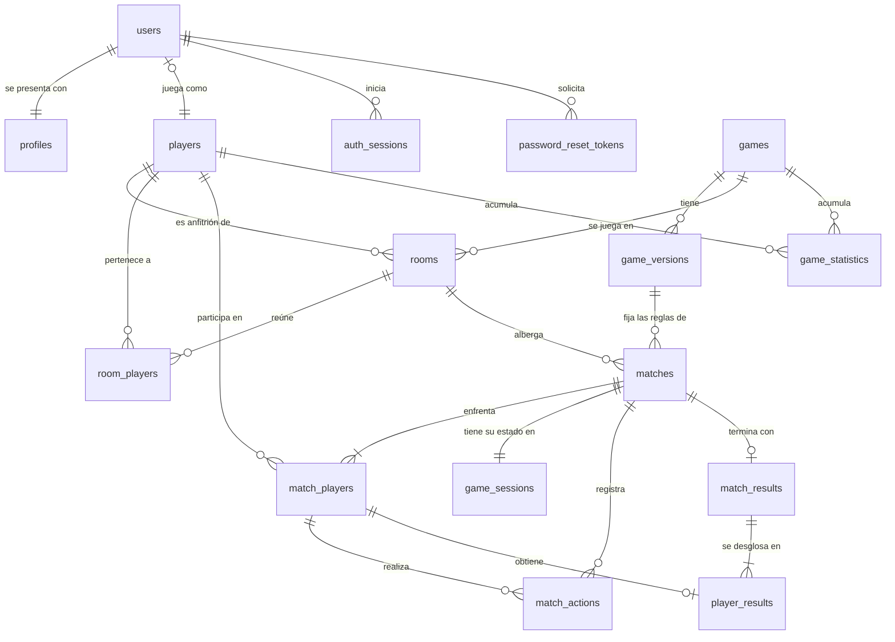

# Dominio y modelo de datos, versión 1

| Campo | Valor |
|---|---|
| **Estado** | Versión 1, aceptada el 2026-11-14 por Fernando Hernandez Argueta |
| **Sustituye a** | El modelo relacional preliminar |
| **Aplica** | ADR-002 (Drizzle sobre PostgreSQL), ADR-004 (sesión con cookie), ADR-008 (alcance del MVP), ADR-009 (reglas de dominio), ADR-010 (persistencia de partida) y ADR-011 (convenciones y glosario) |

**Cómo leer este documento.** Todo lo que deriva de una decisión aceptada cita su ADR o su regla. Las decisiones de diseño propias de este documento están reunidas en la [sección 10](#10-decisiones-de-diseño-propias-de-este-documento).

Este documento describe el modelo lógico. No contiene código ni definiciones de migración; esas se escriben con Drizzle al implementar (ADR-002).

---

## 1. Convenciones

| Asunto | Convención | Origen |
|---|---|---|
| Nombres | Tablas y columnas en inglés y `snake_case`. La API y el protocolo exponen los mismos datos en `camelCase` | 9.1, 9.2 |
| Identificadores | `uuid` generado por el servidor. El identificador de petición (`request_id`) es un `uuid` generado por el cliente | 9.4 |
| Fechas | `timestamptz`, siempre en UTC | 9.3 |
| Duraciones y relojes | Enteros en milisegundos | 9.3 |
| Valores enumerados | `text` con una restricción `CHECK` que limita los valores admitidos | Decisión R2 |
| Datos propios de cada juego | `jsonb`. La plataforma no interpreta su contenido; lo valida el motor del juego | B2 |
| Tablas uno a uno | Usan como clave primaria la clave de la entidad a la que pertenecen | Decisión R3 |
| Borrado | Nada se borra físicamente durante el MVP, salvo sesiones de autenticación, tokens de recuperación y pertenencias a salas | 8.19, 8.20 |

Los cuatro nombres de versión no se mezclan (9.10). En este modelo aparecen dos: `game_versions.version`, que es la versión de las reglas, y `game_sessions.state_version`, que es el contador de cambios de una partida.

---

## 2. Diagrama de entidades



La tabla `server_liveness` no se relaciona con ninguna otra y no aparece en el diagrama.

---

## 3. Tablas

Son 17 tablas en la versión 1. En las columnas "Nulo", "No" significa que el valor es obligatorio.

### 3.1. Identidad

Tres entidades con un papel cada una (9.11): la **cuenta** guarda credenciales, estado y rol; el **perfil**, cómo se presenta la persona; el **jugador**, la identidad que participa en salas y partidas.

#### `users` (cuenta)

| Campo | Tipo | Nulo | Descripción |
|---|---|---|---|
| `id` | `uuid` | No | Clave primaria |
| `email` | `text` | No | Se guarda en minúsculas |
| `username` | `text` | No | Sirve para iniciar sesión y como identificador público (9.12) |
| `password_hash` | `text` | No | Argon2id (ADR-004, condición 5.9) |
| `role` | `text` | No | `USER` o `ADMIN`. Por defecto `USER` (9.15) |
| `status` | `text` | No | `ACTIVE` o `SUSPENDED`. Por defecto `ACTIVE` |
| `email_verified_at` | `timestamptz` | Sí | Reservado. La verificación de correo es posterior al MVP (ADR-008, punto 18) |
| `created_at` | `timestamptz` | No | |
| `updated_at` | `timestamptz` | No | |

Restricciones: `email` único. `username` único sin distinguir mayúsculas de minúsculas, mediante un índice único sobre `lower(username)`.

#### `profiles` (perfil)

| Campo | Tipo | Nulo | Descripción |
|---|---|---|---|
| `user_id` | `uuid` | No | Clave primaria y referencia a `users` |
| `display_name` | `text` | No | El nombre que se muestra. No es único (9.12) |
| `avatar_url` | `text` | Sí | |
| `biography` | `text` | Sí | |
| `updated_at` | `timestamptz` | No | |

#### `players` (jugador)

| Campo | Tipo | Nulo | Descripción |
|---|---|---|---|
| `id` | `uuid` | No | Clave primaria. Es el identificador al que hacen referencia salas, partidas, resultados y estadísticas (9.13) |
| `user_id` | `uuid` | Sí | Referencia a `users`. En el MVP siempre tiene valor; el modelo admite que falte para no cerrar la puerta a los bots (9.14) |
| `created_at` | `timestamptz` | No | |

Restricciones: `user_id` único.

El registro crea la cuenta, el perfil y el jugador en una sola transacción.

#### `auth_sessions` (sesión de autenticación)

| Campo | Tipo | Nulo | Descripción |
|---|---|---|---|
| `id` | `uuid` | No | Clave primaria. No es el valor de la cookie |
| `user_id` | `uuid` | No | Referencia a `users` |
| `token_hash` | `text` | No | Hash del identificador opaco que viaja en la cookie. El identificador en claro no se guarda (ADR-004, condición 5.1) |
| `created_at` | `timestamptz` | No | |
| `last_used_at` | `timestamptz` | No | |
| `expires_at` | `timestamptz` | No | Caducidad por inactividad. Se renueva con el uso. Valor inicial: 30 días (condición 5.6) |
| `absolute_expires_at` | `timestamptz` | No | Tope que la renovación no puede superar. Valor inicial: 90 días (condición 5.6) |

Restricciones: `token_hash` único. Índices por `user_id`, para cerrar todas las sesiones de una cuenta, y por `expires_at`, para la limpieza.

#### `password_reset_tokens` (recuperación de contraseña)

| Campo | Tipo | Nulo | Descripción |
|---|---|---|---|
| `id` | `uuid` | No | Clave primaria |
| `user_id` | `uuid` | No | Referencia a `users` |
| `token_hash` | `text` | No | Hash del token enviado por correo. El token en claro no se guarda |
| `created_at` | `timestamptz` | No | |
| `expires_at` | `timestamptz` | No | |
| `used_at` | `timestamptz` | Sí | Un token usado no vuelve a servir |

Restricciones: `token_hash` único. Índice por `user_id`.

### 3.2. Catálogo

#### `games` (juego)

| Campo | Tipo | Nulo | Descripción |
|---|---|---|---|
| `id` | `uuid` | No | Clave primaria. Es el `gameId` interno (9.5) |
| `slug` | `text` | No | Nombre corto estable con el que la API, el protocolo y el motor identifican al juego. El del primero es `four-in-a-row` (9.5, 9.6) |
| `name` | `text` | No | Nombre visible. El del primero es "Cuatro en raya" |
| `description` | `text` | Sí | |
| `status` | `text` | No | `ACTIVE` o `INACTIVE` |
| `created_at` | `timestamptz` | No | |
| `updated_at` | `timestamptz` | No | |

Restricciones: `slug` único.

#### `game_versions` (versión de un juego)

| Campo | Tipo | Nulo | Descripción |
|---|---|---|---|
| `id` | `uuid` | No | Clave primaria |
| `game_id` | `uuid` | No | Referencia a `games` |
| `version` | `text` | No | Versión semántica de las reglas, por ejemplo `1.0.0` (9.7) |
| `status` | `text` | No | `ACTIVE` o `INACTIVE`. Desactivar una versión solo impide empezar partidas nuevas con ella (7.23) |
| `is_current` | `boolean` | No | Indica la versión vigente del juego, que es la que toman las partidas nuevas (9.8) |
| `released_at` | `timestamptz` | Sí | |
| `created_at` | `timestamptz` | No | |

Restricciones: `(game_id, version)` único. Como mucho una versión vigente por juego, mediante un índice único parcial sobre `game_id` donde `is_current` es verdadero. La versión vigente debe estar activa.

El número de jugadores y los controles de tiempo que admite una versión no se guardan aquí. Los declara el motor (9.9). Ver la decisión R1.

### 3.3. Salas

#### `rooms` (sala)

| Campo | Tipo | Nulo | Descripción |
|---|---|---|---|
| `id` | `uuid` | No | Clave primaria |
| `game_id` | `uuid` | No | Referencia a `games`. La sala no guarda versión (9.8) |
| `owner_player_id` | `uuid` | No | Referencia a `players`. El anfitrión |
| `mode` | `text` | No | `REALTIME` o `TURN_BASED`. No cambia una vez creada la sala (7.1) |
| `time_control` | `jsonb` | No | Control de tiempo elegido al crear la sala (7.2). Ver la forma más abajo |
| `max_players` | `smallint` | No | Capacidad. La plataforma la valida contra lo que declara el motor (9.9) |
| `rematch_enabled` | `boolean` | No | Indica si la sala vuelve a `WAITING` al terminar una partida, para la revancha. En tiempo real siempre es verdadero (7.11). Por turnos lo elige el anfitrión al crear la sala y por defecto es falso (7.31) |
| `settings` | `jsonb` | No | Opciones propias del juego, que se pasan al motor al empezar la partida. Por defecto, un objeto vacío |
| `status` | `text` | No | `WAITING`, `IN_MATCH` o `CLOSED` |
| `close_reason` | `text` | Sí | `OWNER_LEFT`, `IDLE`, `MATCH_ENDED` o `ADMIN`. Solo tiene valor si la sala está cerrada |
| `created_at` | `timestamptz` | No | |
| `last_activity_at` | `timestamptz` | No | Se actualiza cuando alguien entra, sale o se marca listo, y cuando termina una partida. Sirve para el cierre por inactividad (7.14) |
| `closed_at` | `timestamptz` | Sí | Tiene valor si y solo si la sala está cerrada |

Índices: `(game_id, status, mode)` para el listado de salas. Índice parcial sobre `last_activity_at` para las salas en `WAITING`, para la revisión de inactividad.

Forma de `time_control`. El campo `type` nombra la política (7.7). El MVP incluye una sola:

```json
{ "type": "TOTAL_PER_PLAYER", "totalMs": 600000 }
```

#### `room_players` (pertenencia a una sala)

| Campo | Tipo | Nulo | Descripción |
|---|---|---|---|
| `room_id` | `uuid` | No | Referencia a `rooms` |
| `player_id` | `uuid` | No | Referencia a `players` |
| `is_ready` | `boolean` | No | Marca de "listo". Por defecto, falso. Se limpia al terminar cada partida (7.11) |
| `joined_at` | `timestamptz` | No | |

Restricciones: clave primaria `(room_id, player_id)`. Índice por `player_id`.

Esta tabla contiene solo los miembros actuales. El anfitrión también tiene su fila. Cuando alguien sale de la sala, su fila se borra. Quién jugó cada partida queda en `match_players`. Ver la decisión R4.

La presencia, es decir, quién está conectado, no se guarda (7.24).

### 3.4. Partidas

#### `matches` (partida)

| Campo | Tipo | Nulo | Descripción |
|---|---|---|---|
| `id` | `uuid` | No | Clave primaria. Es el único identificador de partida que ven los clientes (9.16) |
| `room_id` | `uuid` | No | Referencia a `rooms`. Una sala puede albergar varias partidas sucesivas (7.11) |
| `game_version_id` | `uuid` | No | Referencia a `game_versions`. Se fija al empezar y no cambia (7.23, 9.8) |
| `mode` | `text` | No | Copia de la modalidad de la sala al empezar |
| `time_control` | `jsonb` | No | Copia del control de tiempo de la sala al empezar |
| `status` | `text` | No | `IN_PROGRESS`, `FINISHED` o `ABORTED` |
| `abort_reason` | `text` | Sí | `ADMIN` o `FAILURE`. Solo tiene valor si la partida está anulada (7.20) |
| `started_at` | `timestamptz` | No | |
| `ended_at` | `timestamptz` | Sí | Instante en que terminó o se anuló |

Restricciones: como mucho una partida `IN_PROGRESS` por sala, mediante un índice único parcial sobre `room_id`. Índice `(room_id, started_at)`, que sirve también para alternar los asientos en la revancha.

La partida no guarda `game_id`: el juego se obtiene a través de su versión. Así no puede haber una partida cuyo juego y cuya versión no coincidan.

#### `match_players` (participante de una partida)

| Campo | Tipo | Nulo | Descripción |
|---|---|---|---|
| `match_id` | `uuid` | No | Referencia a `matches` |
| `player_id` | `uuid` | No | Referencia a `players` |
| `seat` | `smallint` | No | Asiento, empezando en 0. Lo asigna la plataforma al azar al empezar, y lo alterna en la revancha (9.19) |

Restricciones: clave primaria `(match_id, player_id)`. `(match_id, seat)` único: un asiento por jugador y un jugador por asiento. Índice `(player_id, match_id)` para el historial y para "mis partidas en curso".

### 3.5. Estado vivo y registro de jugadas

#### `game_sessions` (sesión de juego)

El estado vivo de una partida. Es un concepto interno del servidor: su existencia no se expone a los clientes (9.16). Hay exactamente una por partida, y se crea en la misma transacción que ella.

| Campo | Tipo | Nulo | Descripción |
|---|---|---|---|
| `match_id` | `uuid` | No | Clave primaria y referencia a `matches` |
| `status` | `text` | No | `ACTIVE` o `CLOSED` |
| `state` | `jsonb` | No | El snapshot: el estado del juego tal como lo serializa el motor. Hay uno solo, que se sobrescribe con cada jugada confirmada (8.1). Es la fuente de verdad (B6, 8.3) |
| `state_version` | `integer` | No | Contador de cambios. Empieza en 0 y aumenta en 1 cada vez que cambia el estado: con cada jugada confirmada y con cada retirada de un asiento |
| `active_seats` | `smallint[]` | No | Asientos que pueden jugar ahora, que son aquellos cuyo reloj está corriendo. En un juego por turnos contiene un solo asiento; en uno con jugadas simultáneas, varios. Vacía si la sesión está cerrada |
| `clocks` | `jsonb` | No | Tiempo restante de cada asiento, en milisegundos, medido en el instante `turn_started_at` (8.4) |
| `turn_started_at` | `timestamptz` | Sí | Instante en que se midieron los relojes. Desde entonces corren los de los asientos activos (7.3) |
| `turn_deadline_at` | `timestamptz` | Sí | Instante en que se agota el primer reloj de los asientos activos si nadie juega. Es `turn_started_at` más el menor de sus tiempos restantes |
| `created_at` | `timestamptz` | No | |
| `updated_at` | `timestamptz` | No | |

Índices: índice parcial sobre `turn_deadline_at` para las sesiones `ACTIVE`. Lo usa la revisión periódica que detecta relojes vencidos (8.17).

Forma de `clocks`, con el asiento como clave:

```json
{ "0": 600000, "1": 583250 }
```

El tiempo que le queda en un momento dado a un asiento activo es su valor guardado menos el tiempo transcurrido desde `turn_started_at`. Los demás asientos conservan su valor guardado. Con cada jugada confirmada se descuenta a cada asiento activo el tiempo transcurrido, y `turn_started_at` pasa a ser el instante de la confirmación. El tiempo lo mide siempre el servidor (7.4).

#### `match_actions` (registro de jugadas)

Cada jugada aceptada, como una fila que solo se añade y nunca se modifica (8.2). Sustituye a la tabla `game_events` del modelo preliminar. No es event sourcing: el estado nunca se reconstruye a partir de este registro (8.3).

| Campo | Tipo | Nulo | Descripción |
|---|---|---|---|
| `match_id` | `uuid` | No | Referencia a `matches` |
| `sequence` | `integer` | No | Número de orden, empezando en 1. Coincide con el `state_version` que resultó de la jugada |
| `player_id` | `uuid` | No | Quién la hizo |
| `request_id` | `uuid` | No | Identificador de petición generado por el cliente (8.12) |
| `action` | `jsonb` | No | La acción, tal como la aceptó el motor |
| `clock_remaining_ms` | `integer` | No | Tiempo que le quedaba a quien jugó, una vez confirmada la jugada |
| `created_at` | `timestamptz` | No | Instante de la confirmación |

Restricciones: clave primaria `(match_id, sequence)`. `(match_id, player_id, request_id)` único, que es lo que impide aplicar dos veces la misma petición (8.12, 8.13). `(match_id, player_id)` hace referencia a `match_players`: solo un participante puede tener jugadas.

### 3.6. Resultados y estadísticas

#### `match_results` (resultado de una partida)

| Campo | Tipo | Nulo | Descripción |
|---|---|---|---|
| `match_id` | `uuid` | No | Clave primaria y referencia a `matches`. Una partida admite un solo resultado (8.15) |
| `reason` | `text` | No | `COMPLETED`, `TIMEOUT`, `RESIGNATION` o `ABANDONMENT` (7.16) |
| `created_at` | `timestamptz` | No | |

Una partida `FINISHED` tiene siempre resultado. Una partida `ABORTED` no lo tiene nunca (7.20).

#### `player_results` (resultado por jugador)

| Campo | Tipo | Nulo | Descripción |
|---|---|---|---|
| `match_id` | `uuid` | No | Referencia a `match_results` |
| `player_id` | `uuid` | No | Referencia a `players` |
| `outcome` | `text` | No | `WIN`, `LOSS` o `DRAW` |
| `score` | `integer` | Sí | Puntos, para los juegos que los tengan. Cuatro en raya no lo usa |

Restricciones: clave primaria `(match_id, player_id)`. `(match_id, player_id)` hace referencia a `match_players`. Índice por `player_id`.

El resultado por asiento lo da siempre el motor, también cuando un jugador agota su tiempo, se rinde o abandona (7.17). En un juego de dos jugadores, ese jugador recibe `LOSS` y su rival recibe `WIN` (7.18).

#### `game_statistics` (estadísticas básicas)

| Campo | Tipo | Nulo | Descripción |
|---|---|---|---|
| `player_id` | `uuid` | No | Referencia a `players` |
| `game_id` | `uuid` | No | Referencia a `games` |
| `played` | `integer` | No | Por defecto 0 |
| `wins` | `integer` | No | Por defecto 0 |
| `losses` | `integer` | No | Por defecto 0 |
| `draws` | `integer` | No | Por defecto 0 |
| `updated_at` | `timestamptz` | No | |

Restricciones: clave primaria `(player_id, game_id)`. `played` es igual a la suma de los otros tres contadores.

### 3.7. Operación

#### `server_liveness` (anotación de actividad del servidor)

Una sola fila. El servidor anota de forma periódica que sigue en marcha, para poder calcular al arrancar cuánto tiempo estuvo parado (8.18).

| Campo | Tipo | Nulo | Descripción |
|---|---|---|---|
| `id` | `smallint` | No | Clave primaria. Siempre vale 1 |
| `started_at` | `timestamptz` | No | Último arranque |
| `last_alive_at` | `timestamptz` | No | Última anotación. Valor inicial del intervalo: 10 segundos |

---

## 4. Valores enumerados

| Tabla y campo | Valores | Origen |
|---|---|---|
| `users.role` | `USER`, `ADMIN` | 9.15 |
| `users.status` | `ACTIVE`, `SUSPENDED` | ADR-008, punto 15 |
| `games.status`, `game_versions.status` | `ACTIVE`, `INACTIVE` | ADR-008, punto 15 |
| `rooms.mode`, `matches.mode` | `REALTIME`, `TURN_BASED` | 9.20 |
| `rooms.status` | `WAITING`, `IN_MATCH`, `CLOSED` | 9.20 |
| `rooms.close_reason` | `OWNER_LEFT`, `IDLE`, `MATCH_ENDED`, `ADMIN` | 7.12, 7.14, 7.31 y ADR-008, punto 15 |
| `matches.status` | `IN_PROGRESS`, `FINISHED`, `ABORTED` | 9.20 |
| `matches.abort_reason` | `ADMIN`, `FAILURE` | 7.20 |
| `game_sessions.status` | `ACTIVE`, `CLOSED` | 9.20 |
| `match_results.reason` | `COMPLETED`, `TIMEOUT`, `RESIGNATION`, `ABANDONMENT` | 9.20 |
| `player_results.outcome` | `WIN`, `LOSS`, `DRAW` | |
| `time_control.type` | `TOTAL_PER_PLAYER` | 7.7 |

---

## 5. Estados y transiciones

### Sala

| De | A | Qué lo provoca | Regla |
|---|---|---|---|
| | `WAITING` | Se crea la sala | |
| `WAITING` | `IN_MATCH` | Empieza una partida | 7.9, 7.10 |
| `IN_MATCH` | `WAITING` | La partida termina o se anula, y la sala admite revancha (`rematch_enabled`) | 7.11, 7.31 |
| `IN_MATCH` | `CLOSED` | La partida termina o se anula, y la sala no admite revancha | 7.31 |
| `WAITING` | `CLOSED` | El anfitrión sale, la sala lleva demasiado tiempo inactiva o la cierra un administrador | 7.12, 7.14 |
| `IN_MATCH` | `CLOSED` | La cierra un administrador. La partida en curso se anula en la misma transacción | Decisión R8 |

`CLOSED` es final. "Todos listos" no es un estado: se calcula a partir de `room_players.is_ready`.

### Partida

| De | A | Qué lo provoca | Regla |
|---|---|---|---|
| | `IN_PROGRESS` | Se crea la partida, junto con sus participantes y su sesión de juego | |
| `IN_PROGRESS` | `FINISHED` | Fin natural, tiempo agotado, rendición o abandono | 7.16 |
| `IN_PROGRESS` | `ABORTED` | Decisión de un administrador o fallo técnico irrecuperable | 7.20 |

`FINISHED` y `ABORTED` son finales.

### Sesión de juego

| De | A | Qué lo provoca |
|---|---|---|
| | `ACTIVE` | Se crea junto con la partida |
| `ACTIVE` | `CLOSED` | La partida termina o se anula |

Cargar una sesión en memoria o liberarla no cambia su estado guardado (7.22).

---

## 6. Operaciones transaccionales

Cada operación de esta tabla es una sola transacción: o se guarda todo o no se guarda nada. Nada se envía a los clientes hasta que la transacción se ha confirmado (8.9).

| Operación | Qué escribe | Condición | Regla |
|---|---|---|---|
| **Registro** | Inserta `users`, `profiles` y `players` | `email` y `username` libres | |
| **Crear una sala** | Inserta `rooms` en `WAITING` y la fila del anfitrión en `room_players` | El jugador no supera su límite de partidas simultáneas | 7.30 |
| **Entrar a una sala** | Inserta `room_players`. Actualiza `rooms.last_activity_at` | La sala está en `WAITING` y tiene plaza. El jugador no supera su límite de partidas simultáneas | 7.15, 7.30 |
| **Inicio de partida** | Pasa la sala a `IN_MATCH`. Inserta `matches`, `match_players` con los asientos y `game_sessions` con el estado inicial, la versión 0 y los relojes completos | La sala está en `WAITING` y completa. Además, todos están listos, salvo en la primera partida de una sala por turnos, que no tiene paso de "listo" | 7.9, 7.10, 7.31 |
| **Jugada confirmada** | Actualiza `game_sessions`: snapshot, versión, relojes, asientos activos y fecha límite. Inserta una fila en `match_actions` | La sesión está `ACTIVE` y su `state_version` es el esperado. La actualización debe afectar exactamente a una fila | 8.7, 8.8 |
| **Final de partida** | Lo anterior si el final lo produce una jugada. Además: cierra la sesión, pasa la partida a `FINISHED`, inserta `match_results` y `player_results`, actualiza `game_statistics`, y devuelve la sala a `WAITING` limpiando las marcas de listo o, si no admite revancha, la cierra | La sesión está `ACTIVE` y su `state_version` es el esperado | 8.14, 8.15, 8.16, 7.31 |
| **Anulación** | Cierra la sesión, pasa la partida a `ABORTED` y devuelve la sala a `WAITING` o la cierra, igual que en el final de partida. No inserta resultados ni toca estadísticas | La partida está `IN_PROGRESS` | 7.20 |
| **Ajuste tras una caída** | Al arrancar, desplaza `turn_started_at` y `turn_deadline_at` de todas las sesiones `ACTIVE` tanto como el servidor estuvo parado | Se calcula con `server_liveness.last_alive_at` | 7.29, 8.18 |

Los finales por tiempo agotado, rendición y abandono pasan por la misma operación de final de partida. La condición sobre `state_version` evita que un vencimiento y una jugada simultáneos se apliquen los dos: el que llega segundo encuentra otra versión, se descarta y se vuelve a evaluar.

Si una transacción falla, el servidor descarta su copia en memoria de esa sesión y la vuelve a cargar desde la base de datos (8.10).

---

## 7. Reglas de integridad

| Regla | Cómo se garantiza |
|---|---|
| Dos personas no ocupan la última plaza de una sala a la vez (7.15) | La entrada bloquea la fila de la sala antes de contar sus miembros |
| Un jugador no supera sus límites de partidas simultáneas (7.30) | La entrada bloquea la fila del jugador antes de contar sus pertenencias. Ver la decisión R7 |
| Una sala tiene como mucho una partida en curso | Índice único parcial en `matches` |
| Un jugador ocupa un solo asiento por partida, y cada asiento tiene un solo jugador | Clave primaria y restricción única de `match_players` |
| Solo un participante puede tener jugadas y resultado en una partida | Referencias compuestas a `match_players` |
| Una jugada no se aplica dos veces (8.12) | Restricción única `(match_id, player_id, request_id)` en `match_actions` |
| Una jugada no se aplica sobre un estado distinto del que vio el jugador (8.11) | La jugada indica su `state_version`; la actualización de la sesión está condicionada a él |
| Una partida no se cuenta dos veces en las estadísticas (8.15) | `match_results` admite una sola fila por partida, y las estadísticas se actualizan en su misma transacción |
| El juego y la versión de una partida coinciden | La partida solo guarda la versión |
| Un juego tiene como mucho una versión vigente (9.8) | Índice único parcial en `game_versions` |
| Toda versión activa tiene un motor registrado | Comprobación al arrancar el servidor. Ver la decisión R1 |
| Una cuenta con partidas no se borra (8.20) | Las referencias a `players` no permiten el borrado |

---

## 8. Lo que no se guarda

Según la regla 8.5 y la 7.24: los mensajes WebSocket, la presencia, las suscripciones, las jugadas rechazadas y los eventos de juego que el motor emite para las notificaciones.

Tampoco se guarda un historial de snapshots (8.1).

---

## 9. Cambios respecto al modelo preliminar

| Cambio | Motivo |
|---|---|
| Nueva tabla `auth_sessions` | ADR-004 |
| Nueva tabla `password_reset_tokens` | ADR-008, punto 17 |
| Nueva tabla `server_liveness` | 8.18 |
| `game_events` se sustituye por `match_actions` | 8.2. Resuelve el hallazgo C-08 |
| `game_ratings` no se crea en la versión 1 | La puntuación es posterior al MVP (ADR-008, punto 14) |
| `users` gana `role` y `email_verified_at` | 9.15 y ADR-008 |
| `players` pierde `nickname` | 9.12. Resuelve el hallazgo C-21 |
| `players.user_id` admite nulo | 9.14 |
| `games` pierde `min_players` y `max_players` | 9.9. Pertenecen a la versión y los declara el motor |
| `game_versions` gana `is_current` | 9.8. Resuelve el hallazgo C-06 |
| `rooms` gana `mode`, `time_control`, `rematch_enabled`, `close_reason`, `last_activity_at` y `closed_at` | 7.1, 7.2, 7.12, 7.14 y 7.31 |
| `matches` gana `mode`, `time_control` y `abort_reason`, y pierde `game_id` | La partida conserva las condiciones con las que empezó. El juego se obtiene de la versión |
| `game_sessions` gana `active_seats`, `clocks`, `turn_started_at` y `turn_deadline_at` | 8.4, 8.17 y decisión R10 |
| Estados de sala, partida y sesión de juego | ADR-009. Resuelve los hallazgos C-11 y C-13 |
| Se retiran `profiles.preferences`, `players.status`, `rooms.visibility`, `room_players.role`, `room_players.status`, `match_players.team`, `match_players.status`, `match_results.status`, `match_results.completed_at` y `game_sessions.last_activity_at` | Ninguna capacidad del MVP los usa, o repiten un dato que ya está en otra tabla. Ver la decisión R5 |

---

## 10. Decisiones de diseño propias de este documento

Estas decisiones no derivan de un ADR: se tomaron al escribir el modelo. Fueron **aceptadas el 2026-11-14** por Fernando Hernandez Argueta. La R10 se añadió y se aceptó el 2026-11-15.

| ID | Decisión | Alternativa descartada | Motivo |
|---|---|---|---|
| R1 | El número de jugadores y los controles de tiempo que admite una versión **no se guardan en la base de datos**. La única fuente es lo que declara el motor. Al arrancar, el servidor comprueba que cada versión activa tiene su motor | Guardar una copia en `game_versions` | Con una copia habría dos fuentes que pueden discrepar, y un mecanismo para sincronizarlas |
| R2 | Valores enumerados como texto con restricción `CHECK` | Tipos enumerados de PostgreSQL | Añadir o retirar un valor es una migración más sencilla |
| R3 | Las tablas uno a uno (`profiles`, `game_sessions`, `match_results`) usan la clave de su entidad principal como clave primaria | Identificador propio más restricción única | Un identificador menos por tabla, y la relación uno a uno queda garantizada por construcción |
| R4 | `room_players` contiene solo los miembros actuales; al salir se borra la fila | Conservar la fila con un estado "salió" | La pertenencia es un dato del presente. El historial de quién jugó está en `match_players` |
| R5 | Retirar los campos sin uso en el MVP que figuran en la última fila de la sección 9 | Conservarlos por si acaso | Añadir una columna más adelante es sencillo; mantener columnas sin significado definido crea dudas |
| R6 | Revocar o cerrar una sesión de autenticación **borra su fila**. No se conserva historial de sesiones | Marcar la fila como revocada | Menos datos personales guardados. El MVP no tiene ninguna pantalla que muestre sesiones pasadas |
| R7 | Los límites de partidas simultáneas (7.30) se cuentan como **pertenencias a salas no cerradas**, por modalidad. Cubre tanto la sala en la que se espera como la partida en curso | Contar solo partidas `IN_PROGRESS` | Precisa la regla 7.30. Contar pertenencias impide acumular salas en espera por encima del límite |
| R8 | Cuando un administrador cierra una sala con una partida en curso, la partida se anula en la misma transacción. Cuando una partida se anula sin que nadie cierre la sala, la sala sigue la misma regla que al terminar una partida: vuelve a `WAITING` si admite revancha y se cierra si no | Impedir el cierre mientras haya partida | Precisa las reglas 7.11 y 7.20, que no cubrían estos dos casos |
| R9 | La rendición no se anota en `match_actions`. Queda reflejada en el resultado, con el motivo `RESIGNATION` | Anotarla como una fila más | La rendición es una orden de la plataforma, no una jugada del motor (7.19) |
| R10 | `game_sessions` guarda una **lista de asientos activos**, no un solo asiento | Un solo asiento activo | Deja el modelo preparado para juegos con jugadas simultáneas. Un juego por turnos guarda una lista de un elemento, así que no le supone ningún coste. Coincide con el contrato del motor |

---

## 11. Asuntos abiertos

| Asunto | Situación |
|---|---|
| **Nombre visible de un jugador sin cuenta.** El nombre visible está en el perfil, que pertenece a la cuenta. Un jugador sin cuenta, como un bot, no tendría de dónde tomarlo | Posterior al MVP. Se resuelve cuando se diseñen los bots |
| **Política de borrado.** Durante el MVP se conserva todo (8.19) | Se define antes del lanzamiento público, junto con el alojamiento |
| **Registro de acciones de administración.** Quién suspendió una cuenta o anuló una partida no queda guardado en este modelo | Fuera de la versión 1. Conviene valorarlo antes del lanzamiento público |
