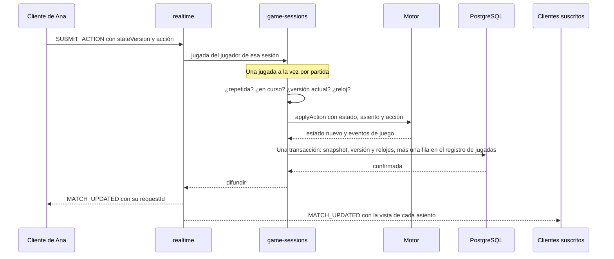

# Flujos y persistencia

| Campo | Valor |
|---|---|
| **Estado** | Versión 1 |
| **Sustituye a** | El documento inicial de corte vertical y persistencia |
| **Recoge** | ADR-009 (reglas de dominio), ADR-010 (persistencia de partida), el modelo de datos y los contratos |

Este documento cuenta de principio a fin cómo se usan juntas las piezas ya aceptadas. No toma ninguna decisión nueva. Donde discrepe de un ADR o de un contrato, valen ellos.

---

## 1. Qué se guarda y dónde

| Dónde | Qué | Origen |
|---|---|---|
| **PostgreSQL** | Cuentas, catálogo, salas, partidas, el estado vivo de cada partida con sus relojes, el registro de jugadas, resultados y estadísticas. Es la fuente de verdad | ADR-007, acuerdo B6 |
| **Memoria del servidor** | Conexiones, suscripciones, presencia, sesiones de juego cargadas y temporizadores. Es una caché: se puede perder entera sin perder ninguna jugada | ADR-009, reglas 7.22 y 7.24 |
| **No se guarda** | Mensajes WebSocket, presencia, suscripciones, jugadas rechazadas y eventos de juego | ADR-010, regla 8.5 |

De cada partida hay un único snapshot, que se sobrescribe con cada jugada, y un registro de jugadas al que solo se añaden filas. El estado nunca se reconstruye a partir del registro: no es event sourcing (ADR-010, reglas 8.1 a 8.3).

No hay Redis en el MVP (ADR-007, acuerdo B7).

---

## 2. Corte vertical: una partida de Cuatro en raya en tiempo real

| # | Qué ocurre | Canal | Detalle |
|---|---|---|---|
| 1 | Ana se registra | API | `POST /auth/register` crea la cuenta, el perfil y el jugador en una transacción, e inicia la sesión |
| 2 | La aplicación abre la conexión de tiempo real | WebSocket | La identidad va en la cookie. El servidor responde `CONNECTION_ESTABLISHED` |
| 3 | Ana mira el catálogo | API | `GET /games` trae cada juego con los jugadores y los controles de tiempo que su motor declara |
| 4 | Ana crea una sala | API | `POST /rooms`, con el juego, la modalidad y el control de tiempo. La sala nace en `WAITING` con Ana como anfitriona. Ana se suscribe con `SUBSCRIBE_ROOM` |
| 5 | Luis entra a la sala | API | `PUT /rooms/{roomId}/members/me`. La plaza se comprueba de forma atómica (7.15). Ana recibe `ROOM_UPDATED`. Luis se suscribe |
| 6 | Los dos se marcan listos | API | `PUT /rooms/{roomId}/members/me/ready` |
| 7 | La partida empieza sola | | Con la segunda marca de listo, y en esa misma transacción ([sección 3](#3-inicio-de-partida)) |
| 8 | Los dos se enteran | WebSocket | Reciben `ROOM_UPDATED`, con la sala en `IN_MATCH`, y `PLAYER_MATCH_UPDATED`. Cada uno se suscribe con `SUBSCRIBE_MATCH` y recibe la vista de su asiento |
| 9 | Ana juega | WebSocket | `SUBMIT_ACTION`, con la versión del estado que tenía delante y la acción ([sección 4](#4-jugada-confirmada)) |
| 10 | Los dos ven la jugada | WebSocket | `MATCH_UPDATED`, con el estado nuevo, los relojes y a quién le toca |
| 11 | Alguien alinea cuatro | | La última jugada y el final se guardan juntos ([sección 5](#5-final-de-partida)) |
| 12 | Los dos ven el resultado | WebSocket | `MATCH_UPDATED` con el resultado, `PLAYER_MATCH_UPDATED`, y `ROOM_UPDATED` con la sala de vuelta en `WAITING` para la revancha (7.11) |
| 13 | Ana consulta su historial | API | `GET /me/matches?status=FINISHED` |

Una partida por turnos sigue el mismo camino con tres diferencias: no hay paso de "listo" en la primera partida, porque empieza al completarse la sala (7.10); los jugadores no tienen que coincidir conectados, y se enteran del turno por `PLAYER_MATCH_UPDATED` o al pedir "mis partidas"; y al terminar, la sala se cierra salvo que el anfitrión activara la revancha (7.31).

---

## 3. Inicio de partida

Nadie inicia una partida a mano. La desencadena la operación de la API que completa las condiciones: marcarse listo en tiempo real (7.9) o entrar a la sala por turnos (7.10).

En una sola transacción:

1. Se comprueba que la sala sigue en `WAITING` y está completa.
2. Se toma la versión vigente del juego. La partida la conserva hasta terminar (9.8, 7.23).
3. La plataforma sortea los asientos. En una revancha se alternan (9.19).
4. El motor crea el estado inicial, con una semilla que le da la plataforma, e indica qué asientos juegan primero.
5. Se guardan la partida, sus participantes con su asiento, y la sesión de juego con el estado inicial, la versión 0 y los relojes completos.
6. La sala pasa a `IN_MATCH`.

Después de confirmar la transacción se envían los avisos. La respuesta de la API ya trae la sala en `IN_MATCH` con el identificador de la partida.

---

## 4. Jugada confirmada

Es el camino de toda jugada, en las dos modalidades (ADR-010, reglas 8.6 a 8.13).

| Paso | Regla | Origen |
|---|---|---|
| Identidad | El jugador sale de la sesión de autenticación de la conexión. El mensaje no lleva identificador de jugador | Acuerdo B11 |
| Orden | Las jugadas de una partida se procesan de una en una | 8.6 |
| Jugada repetida | Si ese jugador ya envió ese `requestId` en esta partida, se responde con el estado actual y no se aplica nada. El identificador vive en el registro de jugadas, así que sobrevive a un reinicio | 8.12, 8.13 |
| Versión | La jugada indica sobre qué versión del estado se hizo. Si el estado ya cambió, se rechaza con `STALE_STATE_VERSION` | 8.11 |
| Reloj | El tiempo lo mide el servidor. Una jugada con el reloj agotado se rechaza y se aplica el vencimiento | 7.4, 7.5 |
| Reglas | El motor decide si le toca a ese asiento y si la acción es válida. Es una función pura | Contrato del motor |
| Guardado | Una sola transacción actualiza el snapshot, la versión y los relojes, y añade la fila al registro de jugadas | 8.7 |
| Segunda barrera | La actualización solo se aplica si la versión guardada es la esperada y afecta exactamente a una fila | 8.8; ADR-002, condición 5.5 |
| Aviso | Nada se envía hasta que la transacción se confirma. Cada cliente recibe la vista de su asiento | 8.9 |
| Fallo | Si la transacción falla, el servidor descarta su copia en memoria y la recarga de la base de datos | 8.10 |
| Aviso perdido | Si un aviso no llega, el cliente recupera el estado completo al reconectar | 7.28 |

Las comprobaciones, en su orden exacto y con el código de cada rechazo, están en el [protocolo](../contracts/02-realtime.md), sección 4.

---

## 5. Final de partida

Una partida termina por cuatro motivos (7.16). En todos, el resultado por asiento lo determina el motor (7.17).

| Motivo | Quién lo detecta | Cómo llega al motor |
|---|---|---|
| Fin natural | El motor, al aplicar la última jugada | Es parte de la jugada |
| Tiempo agotado | La capa de sesión, con un temporizador o con la revisión periódica | Le pide retirar ese asiento |
| Rendición | La capa de sesión, al recibir `RESIGN_MATCH` | Le pide retirar ese asiento |
| Abandono, solo en tiempo real | La capa de sesión, tras 2 minutos sin ninguna conexión del jugador (7.26) | Le pide retirar ese asiento |

Los cuatro pasan por la misma transacción (8.14 a 8.16):

1. Se guarda el estado final y se cierra la sesión de juego.
2. La partida pasa a `FINISHED`, con su resultado, su motivo y el resultado de cada jugador.
3. Se actualizan las estadísticas. Como una partida solo admite un resultado, un reintento no puede contarla dos veces.
4. La sala vuelve a `WAITING` sin marcas de listo, o se cierra si es por turnos y no admite revancha (7.11, 7.31).

Si una jugada y un vencimiento llegan a la vez, el que llega segundo encuentra otra versión del estado, se descarta y se vuelve a evaluar.

Una partida **anulada** no tiene resultado ni cuenta en estadísticas. Solo ocurre por decisión de un administrador o por un fallo técnico irrecuperable (7.20). Con la sala hace lo mismo que un final normal.

---

## 6. Relojes

| Regla | Origen |
|---|---|
| Cada jugador tiene un tiempo total para todas sus jugadas. Solo corre el reloj de quien puede jugar | 7.2, 7.3 |
| Los relojes se guardan con el estado, en la misma transacción: tiempo restante de cada asiento, inicio del turno y fecha límite | 8.4 |
| Dos mecanismos detectan un reloj vencido: un temporizador exacto para las sesiones cargadas en memoria, y una revisión periódica de la base de datos que cubre todas las demás | 8.17 |
| El cliente recibe el tiempo restante en el instante de cada aviso y descuenta desde ahí. El tiempo válido es siempre el del servidor | Protocolo, decisión T12 |
| El tiempo que el servidor está caído no se le descuenta a nadie | 7.29 |

---

## 7. Recuperación

### Tras perder la conexión

1. El cliente reintenta con espera progresiva.
2. Al reconectar se suscribe de nuevo a lo que estaba mostrando y recibe el estado completo actual, con los relojes. Sustituye lo que tenía (7.28).
3. Vuelve a pedir "mis partidas", porque pudo perderse avisos.
4. Si tenía una jugada sin respuesta, la reenvía con el mismo `requestId`. El servidor no la aplica dos veces (8.12).

El servidor no recuerda suscripciones ni reenvía mensajes (protocolo, decisión T7). En tiempo real, el jugador tiene 2 minutos para volver antes de perder por abandono (7.26). Por turnos, estar desconectado es lo normal (7.27).

### Tras un reinicio del servidor

1. El servidor anota cada 10 segundos que sigue en marcha. Al arrancar compara esa anotación con la hora actual y sabe cuánto estuvo parado (8.18).
2. Desplaza en esa medida el inicio y la fecha límite del turno en curso de todas las partidas. El plazo de abandono empieza a contar de nuevo (7.29).
3. No carga ninguna sesión de juego por adelantado. Cada una se carga cuando alguien la necesita (7.22), y el motor comprueba que el snapshot guardado es válido.
4. La revisión periódica de relojes cubre las partidas que nadie ha abierto (8.17).
5. Los clientes reconectan como en el caso anterior.

Si el motor no reconoce un snapshot guardado, la partida no puede continuar y se anula por fallo técnico (7.20). Una versión del juego desactivada sigue en el servidor mientras tenga partidas en curso (7.23).

La reconexión y la recuperación son parte del resto del MVP, no del corte vertical (ADR-008, punto 7).

---

## 8. Lo que queda fuera de este documento

| Asunto | Dónde está |
|---|---|
| Cada tabla, con sus campos y sus transacciones | [`03-dominio-datos.md`](03-dominio-datos.md), secciones 3 y 6 |
| Cada operación de la API | [`01-rest-api.yaml`](../contracts/01-rest-api.yaml) |
| Cada mensaje de tiempo real | [`02-realtime.md`](../contracts/02-realtime.md) |
| Qué hace el motor en cada paso | [`03-game-engine.md`](../contracts/03-game-engine.md) |
| Con qué código se rechaza cada cosa | [`04-error-catalog.md`](../contracts/04-error-catalog.md) |
| Quién puede hacer cada cosa | [`05-permissions.md`](../contracts/05-permissions.md) |
| Varias instancias del servidor | Fuera del MVP. Exigiría coordinar entre procesos lo que hoy vive en memoria |
